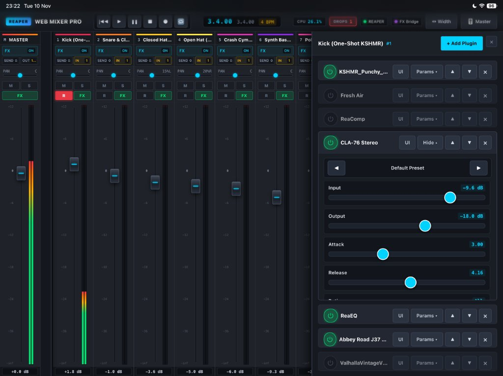

# REAPER Web Mixer Pro 🎛️

[](https://www.reaper.fm/)
[](LICENSE)
[]()
[]()

A high-performance, modern Web Remote Mixer and FX Controller for **Cockos REAPER**. 

Turn your **iPad, Android tablet, smartphone, or second monitor** into a professional touch-enabled mixing console over local Wi-Fi without installing any native apps.

---

<p align="center">
  
</p>

---

## ✨ Key Features

- **⚡ 33+ FPS Ultra-Smooth Volume Meters:** Instantaneous transient attack, calibrated dB scale, and stereo peak clipping LEDs.
- **🎚️ Complete Channel Strip Control:**
  - Precision dB-calibrated faders with dual-rail styling and double-click 0.0 dB reset.
  - Pan controls with center snap and percentage readout.
  - Mute, Solo, and Record Arm toggles.
  - **Record Monitoring modes:** `OFF`, `ON (Normal)`, `AUTO (Tape)`.
  - **Hardware & MIDI Input Selector:** Assign Mono inputs, Stereo pairs, or MIDI controllers directly from your browser.
  - Pinned Master channel strip with 1-click toggle.
- **🔌 Track FX Rack & Live Parameter Tweaker:**
  - View all inserted plugins on any track with 1-tap power bypass (`⏻`) and reordering (`▲` / `▼`).
  - Open plugin GUI in REAPER directly from the browser (`UI` button).
  - **Tweak plugin parameters live** with extra-large 28px/32px touch sliders engineered for iPad fingers.
  - Instant preset stepping (`◀` / `▶`).
- **📦 Complete Plugin Catalog (All 840+ Installed Plugins):**
  - Seamlessly search and insert plugins from your entire library (Waves Audio, FabFilter, Valhalla DSP, Cockos ReaPlugs, iZotope, and JS effects).
  - Infinite streaming scroll with zero stutter and instant live search.
  - One-tap quick brand tabs.
- **🔀 Sends & Routing Drawer:**
  - Create and manage track-to-track sends and hardware outputs.
  - Dedicated send volume faders and mute switches.
- **📊 Real-Time Diagnostic Header:**
  - Live REAPER CPU utilization monitor with warning alerts.
  - Audio Dropout / Buffer Underrun (xrun) detector with 1-tap reset counter (`reaper.GetUnderrunTime`).
  - Full transport cluster: Play, Pause, Stop, Record, Rewind, Repeat, Beats, Timecode, and Tempo display.
- **📱 Dynamic Viewport (`100dvh`):**
  - Dynamic viewport system that adapts to mobile Safari address bars, bottom navigation bars, and orientation changes.
  - Eliminates vertical overflow on iPads and mobile tablets.

---

## 🏗️ How It Works

REAPER Web Mixer Pro consists of two lightweight, cross-platform components:
1. **Web Client (`reaper_www_root/mixer.html`):** A modern, single-file HTML5/CSS/JavaScript web application served directly by REAPER's built-in HTTP server. Zero npm packages, node_modules, or build tools required.
2. **Companion Bridge Daemon (`Scripts/reaper_web_mixer_bridge.lua`):** A lightweight ReaScript running in REAPER's audio loop via `reaper.defer()`. Communicates with the web client via an ExtState sequential RPC queue to expose FX insertion, parameter tweaks, send routing, input selection, and real-time CPU/xrun diagnostics.

---

## 🚀 Quick Setup Guide

### 1. Locate your REAPER Resource Directory
In REAPER, navigate to:
**Options → Show REAPER resource path in explorer/finder...**

### 2. Copy the Files
1. Copy `Scripts/reaper_web_mixer_bridge.lua` into your REAPER **`Scripts`** folder:
   ```
   <REAPER Resource Path>/Scripts/reaper_web_mixer_bridge.lua
   ```
2. Copy `reaper_www_root/mixer.html` and `reaper_www_root/index.html` into your REAPER **`reaper_www_root`** folder:
   ```
   <REAPER Resource Path>/reaper_www_root/mixer.html
   <REAPER Resource Path>/reaper_www_root/index.html
   ```

### 3. Enable Web Remote in REAPER
1. In REAPER, open **Options → Preferences** (`Cmd+,` on macOS, `Ctrl+,` on Windows).
2. Scroll down to **Control/OSC/web** and click **Add**.
3. Set **Control surface mode** to: `Web browser interface`.
4. Choose a port (e.g. `8082`).
5. Set **Default interface** to: `index.html` (or `mixer.html`).
6. Click **Apply** and **OK**.

### 4. Run the Companion Bridge Script
In REAPER:
1. Open the Action List (shortcut `?`).
2. Click **New Action → Load ReaScript...** and select `reaper_web_mixer_bridge.lua` from your `Scripts` folder.
3. Click **Run**.
4. The `FX Bridge` badge in the web mixer header will turn purple/green to confirm connection.

#### 💡 Auto-Start on Launch (Recommended)
To run the bridge automatically whenever REAPER opens, add this line to your `<REAPER Resource Path>/Scripts/__startup.lua` file:
```lua
reaper.defer(function()
  reaper.defer(function()
    dofile(reaper.GetResourcePath() .. "/Scripts/reaper_web_mixer_bridge.lua")
  end)
end)
```
*(If `__startup.lua` does not exist yet, create it in your `Scripts` directory).*

---

## 🌐 Opening the Mixer

- **On your computer:** Open `http://localhost:8082` in any web browser.
- **On your iPad or tablet:** Connect to the same Wi-Fi network and open:
  ```
  http://<YOUR_COMPUTER_IP>:8082
  ```
  *(Example: `http://192.168.1.100:8082`)*

> [!TIP]
> **Full-Screen iPad App:** In Safari on iPad, tap the **Share** button and select **Add to Home Screen**. REAPER Web Mixer will launch as a full-screen, frameless standalone studio app!

---

## ⌨️ Shortcuts & Gestures

| Action | Gesture / Shortcut |
| :--- | :--- |
| **Play / Stop** | Spacebar or Transport Play/Stop button |
| **Reset Volume to 0.0 dB** | Double-click the volume fader or dB readout badge |
| **Reset Pan to Center** | Double-click the pan slider |
| **Reset Dropouts Counter** | Tap the `DROPS` badge in the header |
| **Toggle Master Track** | Tap the `🎚 Master` button in the header |
| **Change Channel Width** | Tap the `↔ Width` button in the header |
| **Bypass Plugin** | Tap the circular `⏻` power button on any plugin card |
| **Open Plugin GUI in REAPER** | Tap the `UI` button on the plugin card |

---

## 🔧 Troubleshooting

- **`FX Bridge` badge is gray / offline:**
  - Make sure `reaper_web_mixer_bridge.lua` is running in REAPER's Action list.
- **Meters move but plugins/sends do not respond:**
  - Standard faders/transport work through REAPER's built-in web server; FX manipulation, routing, and input selection require the companion Lua bridge.
- **iPad screen cuts off the bottom:**
  - Refresh the page once. The dynamic viewport system (`100dvh` + `window.visualViewport`) dynamically measures the visible height and adapts to Safari's address bar.

---

## 📄 License

Distributed under the **MIT License**. See [LICENSE](LICENSE) for details.
Free for personal and commercial studio use. Pull requests and feedback are welcome!
